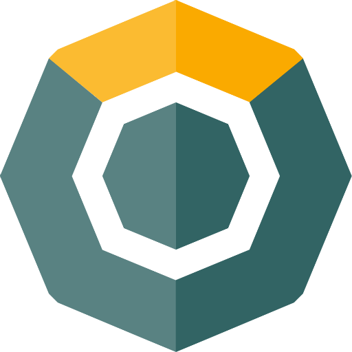

  

  Komodo RPC Library for modern JavaScript

**This package doesn't include [Komodo Binary](https://github.com/KomodoPlatform/komodo/releases) because of security reason. Please setup [Komodo Binary](https://github.com/KomodoPlatform/komodo/releases) in your local first before run this package.**

**This project is bound by a [Code of Conduct][].**

## Examples

-   [Basic example](examples/basic)
-   [Start KMDice chain](examples/start-kmdice.js)
-   [Start mutil chain](examples/start-mutil-chain.js)
-   [Start a chain and call RPC](examples/start-mutil-chain.js)
-   [Start a chain and read its config](examples/read-config.js)
-   [Start a chain with log options](examples/start-chain-with-log.js)

## Documentation

## [Contributing](CONTRIBUTING.md)

## Credits

- **pbca26** - _Initial work and maintainer_ - [pbca26](https://github.com/pbca26)
- **Nam Hoang** - _Maintainer_ - [particle4dev](https://github.com/particle4dev)

See also the list of [contributors](/AUTHORS.md) who participated in this project.

## License

This project is licensed under the MIT license, Copyright (c) 2018 Komodo. For more information see `LICENSE.md`.
